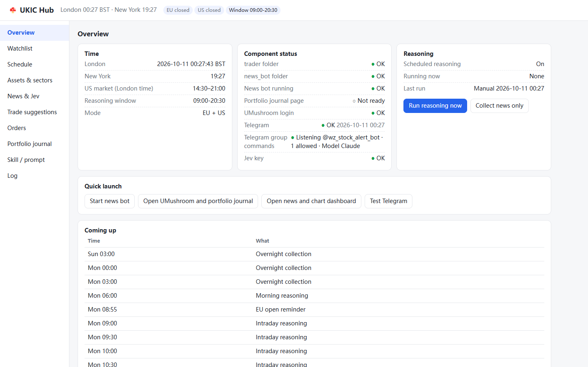
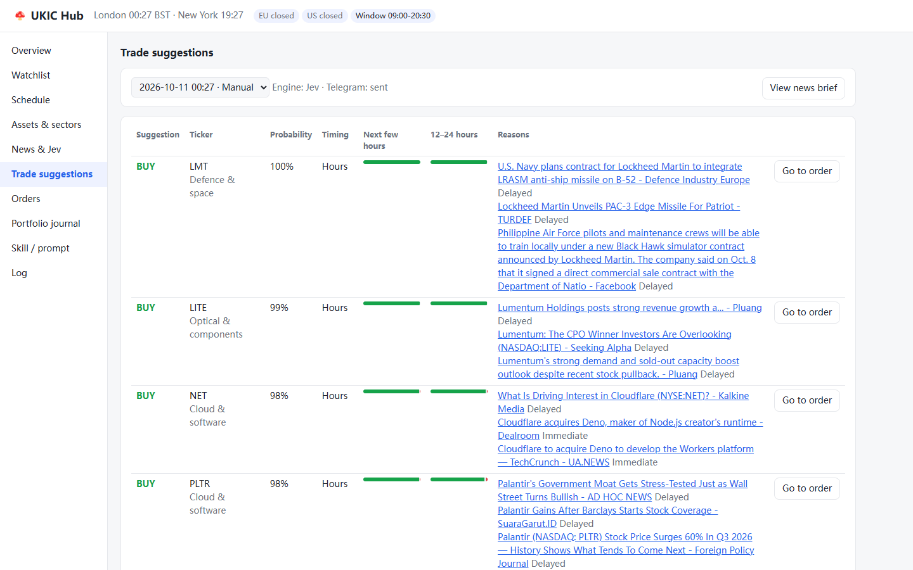
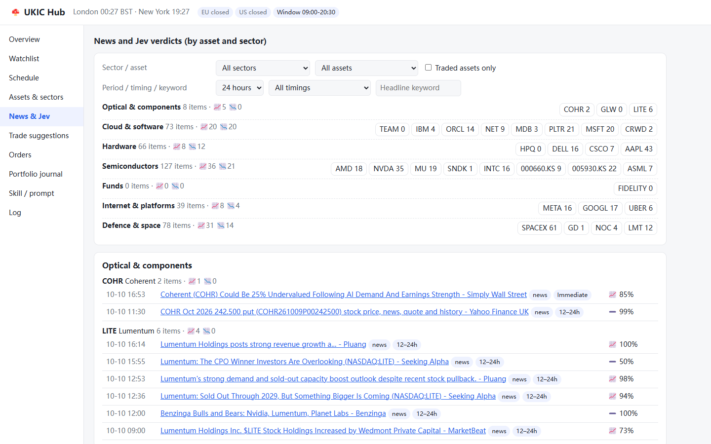
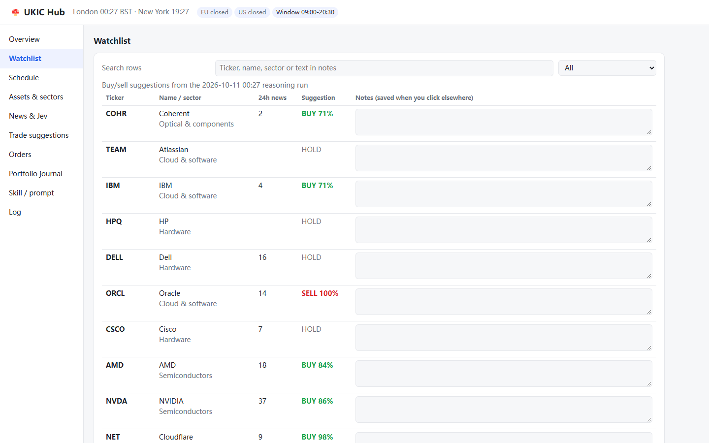
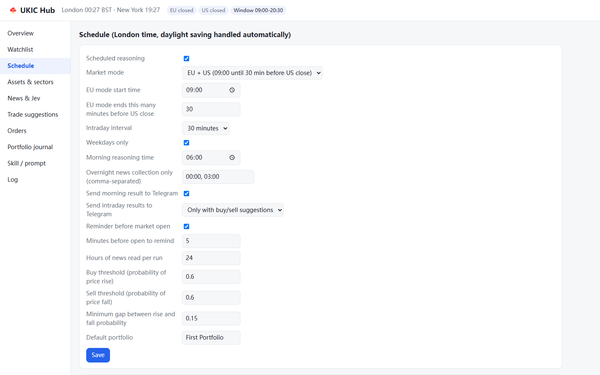
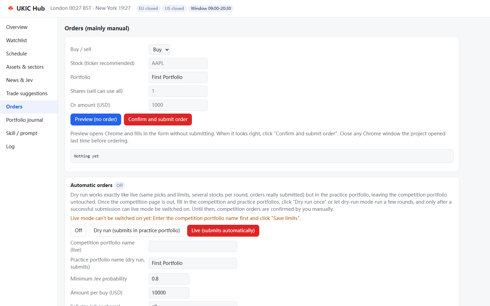
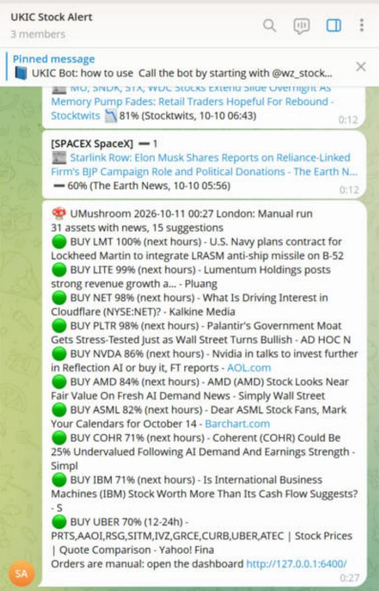
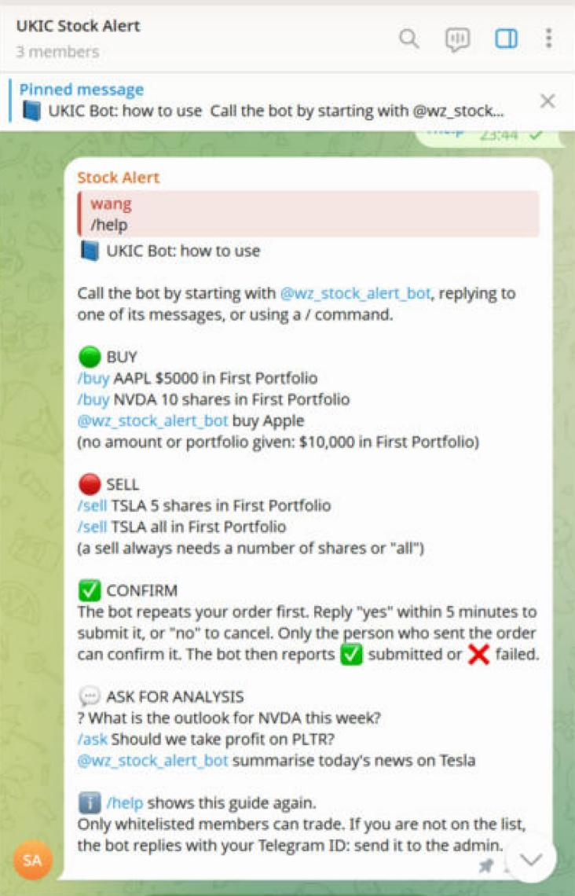

# UKIC Hub: UMushroom competition dashboard

The two earlier projects in one place, plus a dashboard, a schedule and a reasoning pipeline.

```
UKIC_Hub\
├─ trader\      formerly Nick_fixed\UKIC_Nick_fixed (Node): UMushroom buy/sell, order lock, portfolio journal :6420
├─ news_bot\    formerly Stocks_bot (Python): news collection, Jev verdicts, Telegram messages, chart dashboard
├─ hub\         new: dashboard :6400, schedule, reasoning pipeline, Telegram group commands, skill and prompts
│  ├─ server.py       dashboard server (listens on this computer only, 127.0.0.1)
│  ├─ scheduler.py    schedule (London time, daylight saving handled automatically)
│  ├─ pipeline.py     news brief → Jev probabilities → buy/sell/hold suggestions → Telegram
│  ├─ autotrade.py    automatic orders (off by default; dry run in a practice portfolio)
│  ├─ tg_commands.py  Telegram group commands: orders with confirmation, /help, analysis via Claude or Qwen
│  ├─ common.py       paths, settings, time zones
│  ├─ skill\          SKILL.md (Nick's five-point structure) and the scheduled-session prompt
│  ├─ web\            dashboard page
│  └─ data\           assets.json (sectors, traded or not, timing rules), settings.json, briefs\, decisions\, hub.log
├─ start_hub.bat              the one entry point: on the first run moves the two old folders in and fixes paths; after that starts the news bot + dashboard + schedule
└─ install_autostart_hub.bat  optional: start at login (undo with remove_autostart_hub.bat)
```

## Screenshots

Taken on 11 October 2026 after a manual reasoning run ("Run reasoning now"). Jev scored 31 assets with news and suggested 11 BUYs and 4 SELLs; the result went to Telegram. Automatic orders were off, so nothing was ordered.

### Overview

Clock and market windows, the status of every part (trader, news bot, UMushroom sign-in, Telegram, group commands, Jev), and the coming schedule.



### Trade suggestions

Each traded asset with its suggestion, Jev probability, the "next few hours" and "12–24 hours" probability bars (green rise, grey flat, red fall), and the headlines behind it. "Go to order" fills in the order form.



### News and Jev verdicts

News by sector and asset, with Jev's direction and confidence for each headline and whether it acts within hours or in 12–24 hours.



### Watchlist

Every followed stock with its 24-hour news count, the latest suggestion and your own notes (bulk paste supported).



### Schedule

All timings and thresholds, in London time.



### Orders

Manual orders (preview first, then submit) and the automatic-order panel with its limits. Automatic orders are off.



### Telegram: reasoning result

What the club group receives after a reasoning run.



### Telegram: bot guide

`/help` in the group; this message is pinned as the group's guide.



### Order commands

How the bot reads group messages (output of the order parser in `hub/tg_commands.py`). Every order is repeated back and only submitted after the sender replies "yes".

| Message in the group | Bot's reply |
|---|---|
| `/buy AAPL $5000 in First Portfolio` | Please confirm: BUY AAPL $5000, portfolio: First Portfolio |
| `@wz_stock_alert_bot buy Apple` | Please confirm: BUY Apple $10000, portfolio: First Portfolio |
| `@wz_stock_alert_bot 买 苹果` | Please confirm: BUY AAPL $10000, portfolio: First Portfolio |
| `/sell TSLA all in First Portfolio` | Please confirm: SELL TSLA all shares, portfolio: First Portfolio |
| `/sell TSLA` | Can't place this order: Please give a number of shares (e.g. 100 shares) or an amount (e.g. $5000). |

### Trader tests

`npm test` in `trader\` (local mock pages, no real orders): 72 tests, 70 passed, 0 failed, 2 skipped (the two that need a real UMushroom sign-in).

## First run

1. Close the Stock News Bot window, any Chrome window the project opened, and any VS Code / PyCharm window open on the two folders.
2. Double-click `start_hub.bat`. On the first run it:
   - moves `..\Nick_fixed\UKIC_Nick_fixed` to `trader` and `..\Stocks_bot` to `news_bot` (git history, the UMushroom sign-in, alerts.db and logs move with them)
   - removes the old Stocks_bot autostart entry
   - rewrites the old path in `trader\mcp.json`
   - leaves `With_Nick` untouched
3. It then starts everything and opens http://127.0.0.1:6400/ in the browser. From then on, double-click only this file each day.

No other paths need changing: news_bot's `.py` and `.bat` files already use relative paths, and so does trader's `src\config.js`.
If you set up the UMushroom MCP server in a client such as Claude Desktop, change its path to `...\UKIC_Hub\trader\src\server.js`.

Only one hub runs at a time: starting `start_hub.bat` again while it is running just opens the dashboard.

## Schedule (default: EU + US stocks)

| Time (London) | What happens |
|---|---|
| 00:00, 03:00 | Collect news and build the news brief only, no reasoning |
| 06:00 | Morning reasoning; the result goes to Telegram (before 07:00) |
| 08:55 | Reminder: the EU session starts |
| Every 30 minutes from 09:00 until 30 minutes before the US close | Intraday reasoning; Telegram only when there is a buy or sell suggestion |
| 5 minutes before the US open | Reminder: open UMushroom to place orders |

Daylight saving is handled automatically: the UK returns to winter time on 25 October and the US on 1 November. In that week US stocks trade 13:30–20:00 London time, the window becomes 09:00–19:30, and the dashboard shows a notice at the top. Everything can be changed on the "Schedule" tab (US only, 60-minute interval, thresholds and so on).

## How reasoning works (Nick's five points)

1. Purpose: only for the UMushroom competition; organise the news for Jev.
2. Assets and sectors: the assets ticked "Trade" in `hub\data\assets.json`. Each news item is classified by keywords as "immediate" (within hours) or "delayed" (12–24 hours).
3. Format: Jev gets at most 8 headlines per asset, each marked with its time, timing and type.
4. Fed to Jev automatically: it is asked for the probability of "price rise / price down / no clear move" over two horizons, "next few hours" and "12–24 hours".
5. Applying the result: rise probability ≥ 60% and at least 15 points above fall → BUY; the reverse → SELL; otherwise HOLD. Results are written to `hub\data\decisions\` and sent to Telegram.

Without a Jev key, the hub averages the per-article verdicts news_bot has already stored, and the dashboard labels it "Article average".

## Orders

Mostly manual. On "Trade suggestions" click "Go to order", then "Preview" (Chrome fills in the form without submitting), and "Confirm and submit order" once it looks right.

### Automatic orders (off by default)

At the bottom of the "Orders" tab, with three modes: Off / Dry run / Live. The code is in `hub/autotrade.py`; how it calls the trader is in `hub/trader_bridge.py`.

- **Dry run**: after each reasoning run, works exactly like live (same picks and limits, several stocks per round, orders really submitted) but in a separate **practice portfolio**, so the competition portfolio is never touched. The practice portfolio must not have the same name as the competition one.
- **Live**: same flow, submitted in the competition portfolio. It can only be switched on when the competition portfolio name is filled in and a dry run in the practice portfolio submitted an order successfully within the last 7 days ("Dry run once" does this). Switching on also requires typing LIVE.
- **Limits** (all editable on the page): Jev probability ≥ 70%; $10,000 per buy; sells only for stocks already held (from the trader's portfolio journal); at most 2 orders per round and 6 per day; one order per stock per 24 hours; US tickers only; orders only after morning and intraday reasoning.
- **Safety**: if a live order fails (the page doesn't behave as expected), the mode drops back to dry run. Every order is logged in `hub/data/auto_trades.jsonl`, sent to Telegram and shown on the dashboard.
- Automatic orders use the project's own Chrome; close any UMushroom window the project opened while they run.

## Telegram group commands

The hub reads the club's Telegram group in real time (`hub/tg_commands.py`). Type `/help` in the group for the full guide; it is also pinned there.

- **Buy**: `/buy AAPL $5000 in First Portfolio`, `/buy NVDA 10 shares in First Portfolio`, or `@bot buy Apple` (no amount or portfolio: the default amount, `tg_default_amount_usd`, in the default portfolio). Chinese orders and common Chinese company names work too.
- **Sell**: `/sell TSLA 5 shares in First Portfolio` or `/sell TSLA all in First Portfolio`. A sell always needs a number of shares or "all".
- **Confirm**: the bot repeats the order; the same person replies "yes" within 5 minutes to submit, or "no" to cancel.
- **Analysis**: `? question`, `/ask question` or `@bot question` goes to Claude, with Qwen as a fallback (or Qwen first with `LLM_PROVIDER=qwen`).

Set up in `news_bot\.env`: `TELEGRAM_ALLOWED_USERS` (comma-separated Telegram user IDs; anyone else is told their ID), `ANTHROPIC_API_KEY` and/or `DASHSCOPE_API_KEY`. In @BotFather, `/setprivacy` → Disable, so the bot can read group messages.

## Claude scheduled task

`hub\skill\scheduled_prompt.md` is the prompt for a Claude scheduled task. Claude reads the latest news brief and Jev results, reviews them and writes `<id>-claude.json`, which the dashboard shows alongside. The dashboard does not depend on it and works as usual when it hasn't run.
